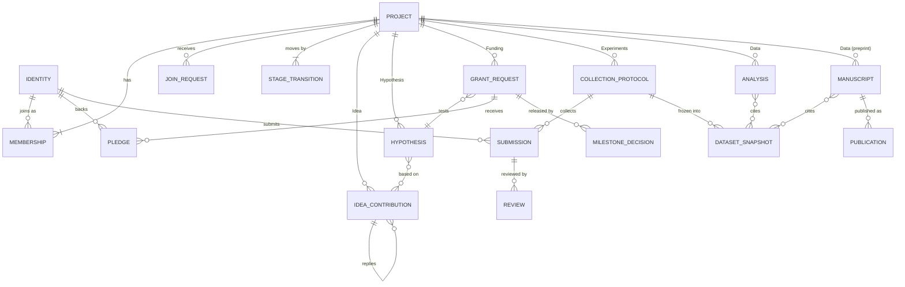
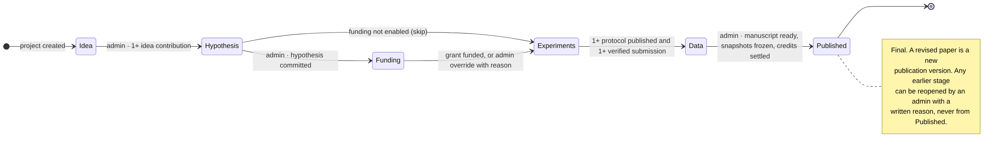

# Open Labbook data model (v1)

Status: proposal, 28 October 2026. Replaces the idea-level model in docs/01 and docs/05 with the **project-level** model below. Machine-readable contract: `schemas/olb-model.schema.json` (JSON Schema 2020-12), checked against `examples/`.

---

## 1. How to represent it formally

Use four layers. Each answers a different question, and together they leave nothing implied.

| Layer | Question it answers | Form | File |
| --- | --- | --- | --- |
| 1. Entities and relationships | What exists, and how many of each relate to what? | Entity–relationship diagram | §3, `diagrams/entities.png` |
| 2. Behaviour | How does a project move between stages, and what must be true to move? | State machine with guard conditions | §4, `diagrams/stages.png` |
| 3. Permissions | Who may do what, in which stage? | Role × action matrix | §5 |
| 4. Contract | What exactly is stored and sent? | JSON Schema 2020-12, one `$defs` entry per record type | `schemas/olb-model.schema.json` |

JSON Schema is the source of truth because the build already validates protocols and submissions with it. It is language-neutral: `olb_core` can generate Rust types from it (for example with `typify`), and QML receives the same JSON. If you later need FAIR linked-data exports (RDF, SHACL), LinkML can generate JSON Schema, and the model can move there without changing the wire format.

Three rules hold for every record:

1. **One envelope, many payloads.** Every record has the same envelope (`id`, `type`, `version`, `project`, `authors`, `parents`, `created_at`, `sig`), and type-specific content in `fields`.
2. **Append-only.** Edits create a new version, and nothing is overwritten. History is a projection of signed commits, not a separate editable table.
3. **Derive, do not duplicate.** Values that can be computed are never stored, including the current stage, review status, totals and who contributed what.

---

## 2. The model in plain words (your outline, completed)

**Project.** It is the unit of research, with a title, summary, field, keywords, licence and references. Its privacy is chosen once at creation: *Open*, *Private* or *Invite only*. It also has an ordered list of the stages it uses (any subset of the six) and settings for anchoring, replicas and visitors. One project follows one line of research from idea to paper.

**Members (Logos users).** A member is a Logos identity, made of an OLB signing key, a sealing key, a self-declared name and an optional ORCID, joined to the project through a **membership** record. Each membership has a role:
- **Admin**: moves stages, publishes the paper, and invites or removes members. A project can have more than one admin.
- **Member**: contributes everything except stage moves and publishing.
- **Reviewer**: reads, reviews, and approves funding milestones, but does not write research content.

**Project stage.** The project is in one of *Idea*, *Hypothesis*, *Funding*, *Experiments*, *Data* or *Published*. The current stage is derived from the latest signed **stage transition**. Only admins move stages, and each forward move has a gate (§4). An admin can move back, which requires a written reason. Published is final; a revised paper is a new version of the publication.

**Idea.** Text contributions from many participants. Each **idea contribution** is a proposal, comment, question or piece of evidence, can reply to another one, and can cite references. Contributions stay open for comments after the project moves on.

**Hypothesis.** Text again, in a structured form: a statement, numbered predictions, what would prove it wrong, an analysis plan, and the idea contributions it grew from. Members review it, an admin commits it, and from then on only a salted fingerprint is on-chain. It is revealed at publication. A project may have more than one hypothesis (H1, H2…).

**Funding.** A **grant request** with an amount, budget lines, milestones, named reviewers and an approval threshold, linked to the hypothesis it tests. Members and external users back it with **pledges**, which are held in escrow by the funding program. Reviewers record **milestone decisions**, and funds are released on-chain when approvals reach the threshold.

> "Invest" is modelled as a contribution with **no financial return**: no equity, interest or revenue share. A return-bearing investment would raise securities questions in most jurisdictions and needs legal advice first.

**Experiments.** One or more **data collection protocols**: versioned form definitions with field types, validation, privacy and review rules (spec: docs/09). A protocol is *draft*, *live* (active) or *closed*. While it is active and the project is at Experiments or later, every allowed contributor sees only its submission form. Each **submission** is signed, is split into a public and a restricted part, and is reviewed by others.

**Data.** Here the team makes sense of the results. A **dataset snapshot** freezes an exact set of submissions from one protocol: protocol, versions, filter, row count and a hash over the included submissions. That makes every chart and conclusion reproducible even while collection continues. An **analysis** is a rich-text document (advanced editor) whose blocks can embed live views of snapshots (table, chart, map, summary) and **conclusion** blocks that state whether a prediction was supported. The **manuscript** (preprint) is drafted here; it cites snapshots, analyses, protocols and hypotheses.

**Published.** An admin publishes the final paper. The **publication** record points to the exact manuscript version and holds the PDF and bundle (paper, data, protocols and provenance), licence, optional DOI, the commitments it reveals, and the credit list (CRediT roles, with AI agents listed separately).

**History.** One log per project, built from its signed commits. Each entry records who did what, in which stage, on which item, and through which protocol (if any). It also records who moved the project between stages and when each change was anchored on-chain. It can be filtered by stage, person or protocol, which shows who contributed where.

**External users** (not members) can do the following, depending on project privacy:

| External user can… | Open | Invite only | Private |
| --- | --- | --- | --- |
| Find the project and see its title, summary and field | Yes | Yes | No |
| Read content (idea, hypothesis text after reveal, public data, paper) | Yes; restricted parts stay hidden | Only after publication | Only after publication |
| Comment on idea contributions | Yes, marked "Visitor" | No | No |
| Pledge to an open grant request | Yes | Yes, via the grant's public page | Only with a direct link from an admin |
| Submit data to a protocol | Only if the protocol allows visitors; always reviewed | No | No |
| Ask to join | Join request | Join request | Invite only |
| Review or comment on the published paper | Yes | Yes | Yes |

---

## 3. Entities and relationships




| Record type | Stage | Created by | Key fields | Versioned |
| --- | --- | --- | --- | --- |
| `project` | — | Admin | title, privacy, stages_enabled, settings | Yes (privacy immutable) |
| `membership` | — | Admin | member, role, status | Yes |
| `join_request` | — | External | requester, note, status | Status only |
| `stage_transition` | all | Admin | from, to, direction, reason, checks | No (one per move) |
| `idea_contribution` | Idea | Member, Visitor (Open) | kind, body, reply_to | Yes |
| `hypothesis` | Hypothesis | Member; Admin commits | label, statement, predictions, commitment | Yes until committed |
| `grant_request` | Funding | Admin | amount, milestones, reviewers, threshold | Yes until opened |
| `pledge` | Funding | Anyone allowed | backer, amount, tx | No (mirrors chain) |
| `milestone_decision` | Funding | Reviewer | milestone, verdict, evidence | No |
| `collection_protocol` | Experiments | Member | form, rules, status | Yes (docs/09) |
| `submission` | Experiments | Member, Visitor | public, restricted | Yes (corrections) |
| `review` | Experiments | Member | target, verdict | No |
| `dataset_snapshot` | Data | Member | protocol, versions, filter, root | No (immutable) |
| `analysis` | Data | Member | body (rich text with embeds) | Yes |
| `manuscript` | Data | Member | body, cites, pdf | Yes |
| `publication` | Published | Admin | manuscript version, pdf, credits | New version for revisions |

---

## 4. Stage state machine



| Move | Who | Guard (all must pass; checked by `olb_core` and recorded in `stage_transition.checks`) |
| --- | --- | --- |
| → Idea | Project creator | Project created |
| Idea → Hypothesis | Admin | At least 1 idea contribution |
| Hypothesis → Funding | Admin | At least 1 hypothesis committed |
| Hypothesis → Experiments (Funding skipped or not enabled) | Admin | At least 1 hypothesis committed |
| Funding → Experiments | Admin | Grant request status `funded`, **or** admin override with a reason |
| Experiments → Data | Admin | At least 1 protocol published and at least 1 verified submission |
| Data → Published | Admin | Manuscript `ready`; every cited snapshot frozen; credits accepted or open for 14 days; no included file with fewer than 2 copies |
| Any → earlier stage | Admin | Written reason; never from Published |

Stages not in `stages_enabled` are skipped automatically, and the move is recorded with `direction: "skip"`.

**What can be edited in which stage**

| Item | Editable while |
| --- | --- |
| Idea contributions | Idea stage; comments allowed at any stage |
| Hypothesis | Hypothesis stage, until committed (then read-only; reveal at publication) |
| Grant request | Draft until opened; then only status changes and milestone decisions |
| Protocols | Draft: any time; publish or close: Experiments stage or later |
| Submissions | While the protocol is active and the stage is Experiments or later; corrections inside the edit window |
| Analysis, manuscript, snapshots | Data stage (snapshots are immutable once frozen) |
| Publication | Created once at Published; revisions add a new version |

---

## 5. Roles and permissions

| Action | Admin | Member | Reviewer | External (Open project) |
| --- | --- | --- | --- | --- |
| Read private and restricted content | Yes | Yes | Yes | No |
| Add idea contributions | Yes | Yes | Comment only | Comment only |
| Write and review hypotheses | Yes | Yes | Review only | No |
| Commit a hypothesis on-chain | Yes | Propose | No | No |
| Create or open a grant request | Yes | Draft | No | No |
| Pledge to a grant | Yes | Yes | Yes | Yes |
| Approve milestones | No (unless named reviewer) | No (unless named reviewer) | Yes, if named | No |
| Create or publish protocols | Yes | Yes | No | No |
| Submit data | Yes | Yes | No | If the protocol allows visitors |
| Verify submissions | Yes | Yes | Project setting | No |
| Write analysis and manuscript; freeze snapshots | Yes | Yes | Comment only | No |
| Move stages | Yes | No | No | No |
| Publish the paper | Yes | No | No | No |
| Invite, remove, change roles | Yes | No | No | No |
| Review or comment on the published paper | Yes | Yes | Yes | Yes |

Researchers never approve funding for their own project: a named reviewer cannot also be a member with role Admin or Member.

---

## 6. History

Every write is one signed commit carrying a small **event** (`$defs/historyEvent` in the schema):

```json
{ "commit": "a41c9e2…", "at": "2026-10-27T07:42:00+05:30",
  "actor": { "key": "3a9d…", "name": "Arjun Mehta", "kind": "member" },
  "action": "submission_added", "stage": "experiments",
  "target": { "type": "submission", "id": "olb:obj:sub-1284", "title": "Indian peafowl · 3" },
  "protocol": "olb:obj:prot-sighting",
  "anchor": { "state": "pending" } }
```

Views built from it:
- **Timeline**: all events, newest first, filterable by stage, person, protocol and action.
- **Who contributed where**: event counts per person × stage, and per person × protocol.
- **Stage moves**: `stage_moved` events with actor, reason and gate results.
- **Credit**: `publication.credits` is suggested from these counts and confirmed by each person.

---

## 7. Changes from the current design and docs

| Current (docs 01/05, canvas) | New model |
| --- | --- |
| Project contains several ideas, each at its own stage | One project = one research line with a single stage. Board idea cards become **project cards**. |
| `idea` record type | `project` + `idea_contribution` |
| `entry` (notebook entry) | Kept as optional lab notes attached to a protocol; data analysis moves to `analysis` |
| `protocol` (written method) | Unchanged; still a text record, cited by collection protocols |
| `dataset`, `result` | `dataset_snapshot` + conclusion blocks inside `analysis` |
| `proposal` | `grant_request` + `pledge` + `milestone_decision` |
| `publication` | Same name, now with fixed manuscript version and credits |
| Idea-level keys for reviewers | Project-level access only (simpler); revisit if per-hypothesis privacy is needed |
| Stage stored on the idea | Derived from the latest `stage_transition` |

---

## 8. Open decisions

1. **Rich-text format and editor.** The schema defines a block format (`olb-blocks/1`), with collaborative editing through a CRDT whose state is stored by CID. QML's built-in rich text is limited, so the "advanced editor" for Data is the biggest UI risk. Decide between a custom QML block editor and a web view, if Basecamp allows one in UI modules.
2. **More than one hypothesis per project.** Allowed here. If you want strictly one, change the cardinality to `||--||` and add a uniqueness check.
3. **Multiple admins approving a stage move.** Currently one admin is enough. A two-admin rule is a small change to the guard.
4. **Grant currency.** The schema uses an `asset` string (testnet: `lez:native-testnet`). No project token.
5. **External comments on Idea in Invite-only projects.** Currently not allowed.
