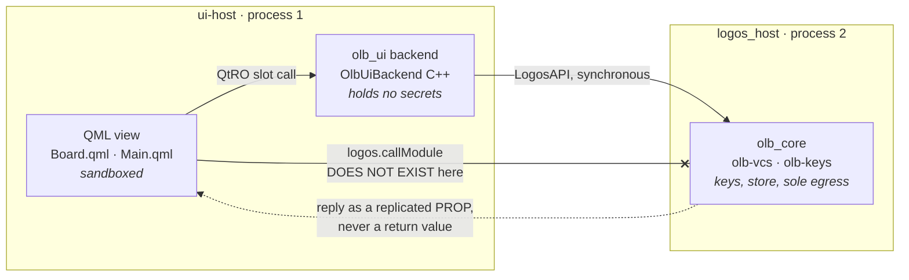
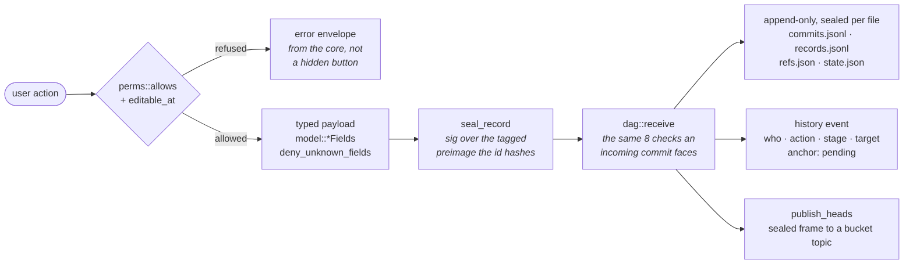
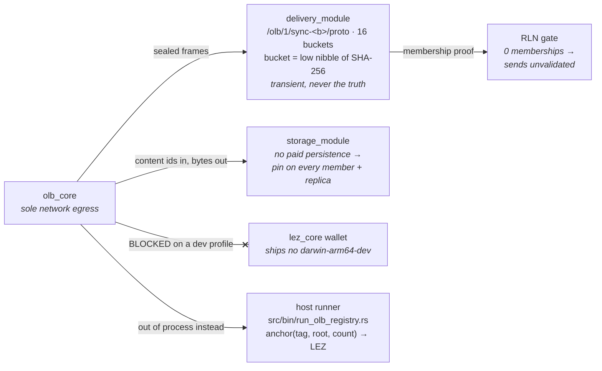

# 14 — Architecture and data flow

How the pieces fit together at runtime: three OS processes, one sandbox boundary
that cannot be crossed, and a store deliberately placed outside everything
Basecamp scrubs. Diagram sources live in `docs/diagrams/*.mmd`; a rendered
version of this page is published as an artifact.

Colour convention throughout, from CLAUDE.md: green = verified / durable /
anchored, violet = in flight, amber = needs attention, slate = neutral.

---

## 1. QML cannot call the core

The UI runs sandboxed: no network, no filesystem outside its own module
directory, and **no `logos.callModule`** on the `ui-qml-backend` path. Every
storage, crypto, chain and network operation makes three hops to reach the
core, each across a process boundary.

Two consequences worth stating, because most of the UI's shape follows from
them:

- **Replies are not return values.** QML calls a `.rep` SLOT and reads the
  answer later from a replicated PROP. A `void` SLOT returns before the backend
  has run, which is why a screen that acts on a result has to wait for a
  property change rather than for the call (`docs/08` R21 for what happens when
  that reply never arrives).
- **Secrets never cross the seam.** Keys, salts and project secrets stay in
  process 2. The UI receives JSON documents and content ids — never key
  material, never file bytes.

---

## 2. What one write does

Every user action that changes data produces a signed commit. Under the v2
model (`docs/13`) the record carries its own signature, and the id and the
signature cover the same bytes — so a record cannot be edited without either
breaking its signature or becoming a different record.

The step that earns its keep is `dag::receive`. A locally authored commit goes
through the same eight checks an incoming one does, so a mistake in our own
tree or version arithmetic fails here rather than on a peer's node.

Permission refusals come back from the core as an error envelope. A hidden
button is not a permission: `docs/13` §5 requires the matrix enforced in
`olb_core`, so a hand-built IPC call hits the same wall a screen does.

---

## 3. Three ways out, and one detour

`olb_core` is the only process with network access, and it reaches the outside
through sibling modules — each its own process, each spoken to over LogosAPI.

Chain anchoring is the exception. `lez_core` publishes `darwin-arm64`,
`linux-amd64` and `linux-arm64` but no `darwin-arm64-dev`, so it cannot install
into a scaffold dev profile at all (`docs/08` R18). Anchoring therefore runs
from a command-line host runner, which is why a chain receipt is a separate
step rather than part of committing.

Chat is absent on purpose: its addresses change on every Basecamp start, so an
address is never an identity (CLAUDE.md constraint 5).

---

## 4. Where state actually lives

`lgs basecamp launch <profile>` wipes the profile on **every** launch, including
`module_data/`. Anything that must survive is kept outside that tree.

| Path | Holds | Survives a relaunch |
| --- | --- | --- |
| `~/Library/Application Support/OpenLabbook/<profile>/` | Identity key, commits, records, refs, project secrets — each file sealed with XChaCha20-Poly1305 | Yes, by design |
| `.scaffold/basecamp/profiles/
/` | Installed modules, `module_data/`, Basecamp's logs | No — scrubbed every launch |
| `.scaffold/dev-store-keys.env` | The hex store key. On a machine with no login keychain this is the **only** copy (R19) | Yes (gitignored) |
| `keyvault.json` | Store key wrapped under Argon2id (64 MiB / 3 / 1) in passphrase mode | Yes |
| Logos Storage | Project files by content id — alive only while some node holds them | Only if pinned |
| Delivery Store | In-flight frames between peers | No — transient |

The store key reaches `olb_core` by one of three routes, in order: an
`OLB_STORE_KEY_HEX_<PROFILE>` override, the OS keychain, or an Argon2id
passphrase vault. Lose all three and the store is unreadable. That is the
design, not an oversight.

---

## 5. What is pure, and what is not

The module crate cannot run `cargo test` — it needs an SDK that exists only
inside the Nix build (`docs/08` R8, R12). So anything worth testing is pushed
down into crates that can.

| Unit | Contains | Testable |
| --- | --- | --- |
| `olb-vcs` | Commit DAG, RFC 6962 Merkle, canonical JSON, the v2 model, stage machine, permissions matrix | Yes — `cargo test` |
| `olb-keys` | Identity, sealed vault, durable store, invites, Argon2id passphrase | Yes — `cargo test` |
| `olb_core` | The LIDL trait, module glue, delivery and storage calls, retry budgets | Nix build only |
| `olb_ui` | `.rep` contract, C++ backend, QML screens | Nix build only |
| `schemas/` | JSON Schema 2020-12 — the contract both sides answer to | `schemas/validate.py`, and Rust tests validate what we emit |

Both pure crates are nested **inside** `olb_core/rust-lib/` with a `[workspace]`
`exclude`, because `olb_core/flake.nix` declares `src = ./.` and nothing outside
that directory reaches the Nix store (R8).
